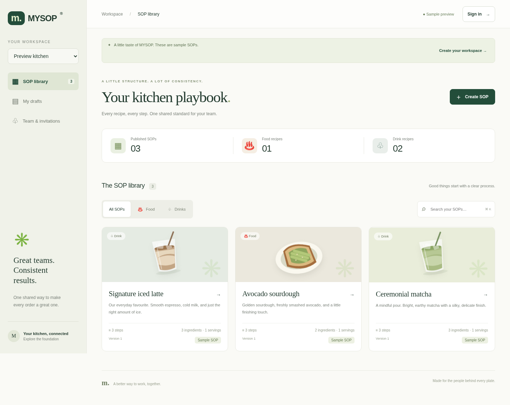

# MYSOP — a shared kitchen playbook

A responsive Python web app for phone and kitchen tablet use: sign in, find food/drink recipes, create a guided SOP with ingredient costs, submit it for review, approve it, and acknowledge updates. FastAPI serves the web interface and API; SQLite persists teams, versioned recipes, review history, live events and acknowledgments. No Node build, API keys or external database are required.



## Start the app

For exact browser instructions on macOS/Linux and Windows, see [Open MYSOP in your browser](docs/OPEN_IN_BROWSER.md). It explains cloud preview limitations and how to test the app on your own computer.

Python **3.12+** is required. From your checkout:

```bash
bash scripts/install.sh
bash scripts/start.sh
```

The install script creates `.venv`, installs the checked-in `requirements.lock`, checks dependencies, and runs the Python tests. The start script serves the interface at `/` on port **8000**, bound to `0.0.0.0`. `PORT=8080 bash scripts/start.sh` selects another port. Visit your machine's host and port in your browser. The root screen initially shows clearly labeled sample recipes; register an account to create real team data. Samples are never inserted into the database.

In this cloud workspace, use `/workspace/MYSOP`; cloud tasks are already isolated and do not require another Git worktree. See [docs/START.md](docs/START.md) for reusable startup and readiness checks. A process or loopback address in the cloud container is not a public preview URL. This onboarding environment has no attached preview forwarding service; screenshots show the actual browser-tested app.

`/health` checks the database, `/docs` provides interactive API documentation, and `/openapi.json` exposes the API contract. Data lives in `data/mysop.sqlite3` by default; set `MYSOP_DB` to override the path. Preserve the database and its WAL/SHM files when restarting. Tests use isolated temporary databases.

Already using MYSOP on a Mac? Follow [Update your Mac without losing saved data](docs/UPDATE_MAC.md) before changing files. It covers backups, an existing Git checkout, a copy extracted from a ZIP, and custom database paths.

## The kitchen workflow

1. **Sign in or register.** Passwords require at least 10 characters. A signed-in user creates a team and becomes its owner, or joins using a single-use invitation.
2. **Assign access.** Under **Team & invitations**, owners invite **supervisors** or **staff**, and can change existing non-owner members between these roles. Invitations expire in 24 hours. They are bearer invitations shared manually; no email is sent.
3. **Create an SOP.** Owners and supervisors choose Food or Drink, then follow four guided steps: **Basics → Ingredients & costing → Method & safety → Review**. A complete SOP requires a title, servings, ingredients with quantities/units, and ordered preparation steps. Allergen and safety fields are available. Complete the guide to save a private draft.
4. **Submit for approval.** Supervisors submit a saved/new draft to the owner. Submitted revisions are locked against edits while pending. Staff cannot view private drafts or pending submissions, and supervisors cannot publish directly.
5. **Review.** The owner opens **Approvals** and checks the exact submitted snapshot, ingredients, cost, method and safety notes. **Approve & publish** creates an immutable team version; **Request changes** requires a note. The supervisor sees that note in My drafts, revises and resubmits. Owners can also create and publish their own recipes directly.
6. **Prepare consistently.** The team browses the published collection, filters Food/Drinks and searches names/descriptions. Recipe detail includes ingredients, costs, allergens, safety notes and all instructions. **Start preparation** provides large step-by-step controls and progress for kitchen tablets. Progress is temporary, separate from acknowledgment.
7. **Acknowledge updates.** After reading the current recipe, each staff member chooses **I have read this version**. Owners and supervisors see a team read/awaiting report. Acknowledgments are durable and version-specific: approving a new version requires a fresh acknowledgment. They record a user's confirmation, not proof of training or food-safety compliance.
8. **Sign out on shared devices.** The header sign-out control remains available on phone/tablet layouts. Sessions are per browser tab and last up to 24 hours. Logout revokes the session and clears local recipe/editor state. Team members should use individual accounts for accurate acknowledgments.

Existing `member` accounts migrate to **staff**. Owners can promote them under Team & invitations. The additive database upgrade preserves existing users, drafts and published versions; legacy recipes remain visible. Back up existing data before upgrading a deployed instance. Owner transfer/removal is not part of this version.

## Ingredient costing

For each ingredient, enter the recipe **quantity** and **unit**. Optionally enter both **pack size in the same unit** and **pack price**. There is no automatic conversion between g/kg, ml/l, pieces or currencies. Choose MYR, SGD, USD, EUR or GBP per recipe; all its ingredient prices use that currency.

Example: 200 ml milk from a 1,000 ml pack costing MYR 8.00 costs MYR 1.60. Another 20 g coffee from a 1,000 g pack costing MYR 60.00 costs MYR 1.20. The recipe totals MYR 2.80; for two servings, MYR 1.40 each.

The server calculates with decimal arithmetic and rounds totals to two places. The editor shows a provisional estimate; published/review detail uses server calculations. If a price is unknown, leave both pack fields empty: the app shows **Cost incomplete** and a known subtotal, rather than treating missing costs as zero. Zero-priced ingredients are allowed explicitly. Prices describe the submitted/published snapshot; editing a draft does not alter older costs. These are ingredient costs only, excluding labour, waste, tax and overhead.

## Access and API

HTTP requests use `Authorization: Bearer <access_token>` from `POST /auth/login`. Registration is `POST /auth/register`; logout is `POST /auth/logout`.

| Capability | Owner | Supervisor | Staff |
| --- | --- | --- | --- |
| Read approved recipes, prepare, acknowledge | Yes | Yes | Yes |
| Create/edit own drafts, submit | Yes | Yes | No |
| Read own drafts/review feedback | Yes | Yes | No |
| Approve or request changes | Yes | No | No |
| Directly publish own SOP | Yes | No | No |
| View team acknowledgment reports | Yes | Yes | No |
| Invite/change non-owner member roles | Yes | No | No |

Core endpoints (prefix with `/teams/{team_id}`):

| Method/path | Purpose |
| --- | --- |
| `POST /sops`, `GET /drafts` | Author a complete draft / list your drafts and review state |
| `PUT /sops/{id}?expected_revision=N` | Save an author revision; stale saves return 409 |
| `POST /sops/{id}/submit?expected_revision=N` | Lock an exact revision for owner review |
| `GET /submissions` | Owner's pending queue |
| `POST /submissions/{id}/approve` | Approve and publish the exact submitted snapshot |
| `POST /submissions/{id}/return` | Request changes with `{"note":"..."}` |
| `POST /sops/{id}/publish?expected_revision=N` | Owner publishes their own unsubmitted draft |
| `GET /sops`, `GET /sops/{id}/versions` | Latest published recipes / immutable version history |
| `POST /sops/{id}/versions/{version}/acknowledge` | Idempotent acknowledgment of a published version |
| `GET /sops/{id}/acknowledgments` | Latest-version team acknowledgment report |
| `POST /invitations` | Invite with `{"role":"staff"}` or `{"role":"supervisor"}` |
| `GET /members`, `PATCH /members/{id}` | Owner lists team / assigns a non-owner role |
| `GET /events?after=N`, WebSocket `/live?after=N` | Durable team event feed |

`POST /teams/join` consumes `{"invitation_token":"..."}`. The full schemas, including optional `pack_quantity`, `pack_cost` and `currency`, are documented at `/docs`. Amounts in stored recipe snapshots may be decimal strings.

## Live updates

Connect to `/teams/{team_id}/live?after=0`, then send `{"token":"<access_token>"}` in the first frame within 10 seconds. Tokens stay out of URL logs. After a `ready` message, events carry a monotonically increasing `id` and types such as `sop.submitted`, `sop.reviewed`, `sop.published`, `sop.acknowledged`, or `team.role_changed`. Event payloads do not contain private draft contents. Staff still cannot access the review queue.

Store the last event ID per user/team and reconnect with `after=<id>` to replay missed events. HTTP polling returns up to 100 events per page; keep fetching until caught up. Publication, approval and event writes are transactional. SQLite is polled every 0.5 seconds per connection. The browser refetches current state on reconnect and processes events in order. An update arriving while an older recipe is open shows a newer-version warning; preparation on that older version stops until the user reopens the latest recipe. Acknowledging an old version never acknowledges the new one.

In-app live updates require connectivity. Native mobile background push, offline editing and cross-device preparation progress are not included.

## Verification and screenshots

```bash
.venv/bin/python -m pytest -q
# Optional real browser workflow (requires system Chromium):
.venv/bin/python -m pip install -r requirements-browser.txt
.venv/bin/python scripts/browser_smoke.py
```

The browser check uses three isolated browser sessions at desktop, tablet and phone sizes. It starts/stops its own server on port 8011 with a temporary database. It verifies login, role invitations, guided creation/costing, draft privacy, supervisor submission, owner return/revision/approval, live publication delivery, staff preparation, acknowledgment persistence/reporting and shared-device sign-out. Screenshots come from that real run:

- [Recipe collection](docs/preview-desktop.png)
- [Phone collection](docs/preview-mobile.png)
- [Owner review](docs/preview-approval.png)
- [Staff recipe detail](docs/preview-staff.png)

Python tests cover approval and role boundaries, team isolation, stale revisions, immutable versions, acknowledgments, cost validation/rounding, existing database migration, auth, durable replay and static assets.

## Saving to GitHub

This repository contains editable application code, the browser interface, tests, dependency files, installation/startup scripts and documentation. Runtime databases, virtual environments, caches and secrets are ignored. Installation/startup never push or commit code. The source was recovered from the archive on `mysop-download-20261021`; the `codex/mysop-source-review` branch retains both that commit and the original `main` history. The ZIP is replaced by editable files on that branch.

For future changes, start from an up-to-date checkout and create a branch:

```bash
git switch -c my-change
# Edit application files, then run .venv/bin/python -m pytest -q.
git add app tests docs README.md
git diff --cached --stat
git diff --cached --check
git commit -m "Describe the change"
git push -u origin my-change
```

Then open a pull request into `main`. Review the staged file list before committing; `.gitignore` does not remove files that were already tracked. See [the complete GitHub steps](docs/OPEN_IN_BROWSER.md#save-the-source-to-github). Keep local data outside source commits.

## Deployment boundary

This is a development foundation for one persistent machine. Before a public production deployment, add HTTPS termination, authentication rate limits, email verification/password recovery, reliable database backups, monitoring and a deployment-specific migration process. Passwords use Argon2; sessions and invitations are stored as digests. Browser session tokens use per-tab session storage, so protect against cross-site scripting and avoid sharing accounts. For distributed deployments, move from SQLite polling to PostgreSQL and an event broker. Source preparation and environment configuration saving do not publish the app to a hosting provider or push to GitHub.
